# Opening a new way of reinforcement learning, Proximal Policy Optimization (PPO) for PID optimization.

This issue uses SIMULINK to build a reinforcement learning-optimized PID control model, employing the PPO algorithm to optimize the PID. The experiment sets up a common second-order model, which can be freely modified.

PPO Principle Overview
The PPO algorithm was proposed by OpenAI in 2017. It is a policy gradient method used in reinforcement learning for continuous control problems. Its main goal is to achieve efficient sampling efficiency while ensuring training stability. The PPO algorithm focuses on simplifying the training process, overcoming the computational complexity of traditional policy gradient methods (such as TRPO), while maintaining training effectiveness.
In traditional policy gradient methods, we update our strategy (i.e., the Actor) through data collection. However, the updated strategy differs significantly from the old one at the time of data collection. This leads to two issues:
Training instability: A poor update can lead to a sharp decline in strategy performance and difficulty in recovery.
Low sampling efficiency: Due to the significant change in the strategy, previously collected data is no longer applicable to the new strategy, necessitating re-sampling, which is very wasteful.
PPO solves this problem through a clever design: it limits the difference between the new strategy and the old one, ensuring that each update is only "a small step," avoiding destructive large updates.
PPO is an improvement to the policy gradient algorithm (PG). It learns to maximize the reward obtained by the agent using the actor-critic algorithm, where the actor and critic work together to learn, as shown in Figure:
In the PG algorithm, the choice of training steps has a significant impact on the training results. When training, using smaller steps can lead to localized difficulties in convergence, while larger steps may cause gradients to increase too quickly, losing fine-grained details of the training process. Therefore, PPO modified the original PG formula by abandoning the PG algorithm and incorporating a new objective function. It also employed the import sampling method, addressing the challenge of determining training steps for the PG algorithm. This modification enhances both the training efficiency and speed.
PPO controller design
The PID algorithm, due to its ease of use and reliability, is widely applied in various industrial control scenarios and is a classic algorithm in control. The PID algorithm consists of three parts: P (proportional), I (integral), and D (differential). When adjusting the error e, the larger the P component, the faster the adjustment speed but can also cause system oscillations; the I component can adjust the input quantity to eliminate static errors, with a larger value leading to faster adjustment speeds and also causing oscillations; the D component can predict the trend of the error and make predictive adjustments in advance, which can reduce oscillations but introduce high-frequency noise. Due to the above characteristics of the PID algorithm, it exhibits time delay and oscillatory behavior under certain nonlinear systems and relies on the professional experience of the operators. Therefore, this period will add the PPO algorithm based on PID for parameter tuning to enhance control performance and achieve adaptive effects, overcoming the shortcomings of traditional PID algorithms that rely on a single parameter.
\n        \n      Setting of the reward function
The reward function directly influences the learning process of the agent's behavior and control strategy in PPO-PID. A well-designed reward function can guide the agent to optimize control performance while adjusting PID parameters, whereas an improperly designed reward function may lead to poor control effects or even cause the agent to deviate from the desired control behavior.
This issue sets the reward function for code generation to the classic ITAE metric, considering the variation in controller U's energy (to prevent frequent controller actions). 
The time-multiplied absolute error integral (ITAE) formula is as follows: 

Set up the controlled object using Simulink, which is simple and easy to modify! Here, a typical second-order system is used. You can also modify this to any model! 

Result display: 
Case 1: Input is a step signal 

Case 2: Input is a sine wave signal 

Case 3: The first two seconds are a step input, followed by a sudden change to a sine wave 

Comparing these three cases, it can be seen that PPO performs excellently in optimizing PID parameters. No matter what input changes, the controller can always track it. 
Code directory: 
To execute this program, MATLAB version 2025a or above is required.

## Images

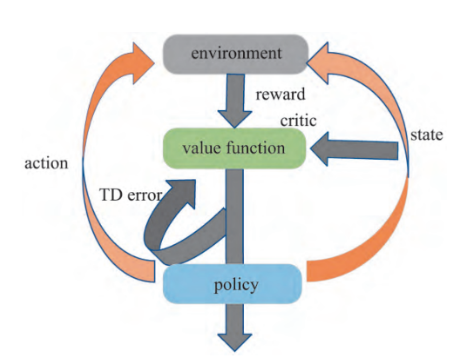
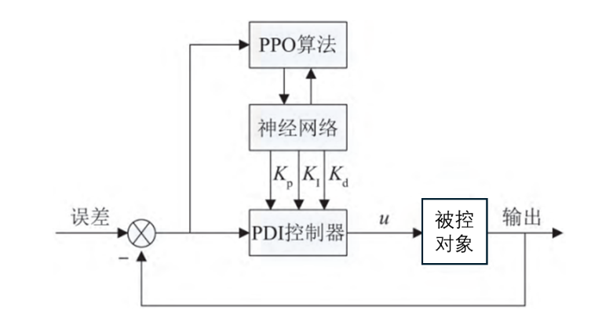
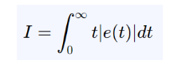
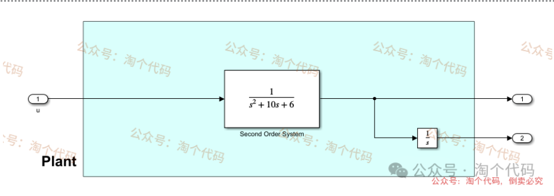
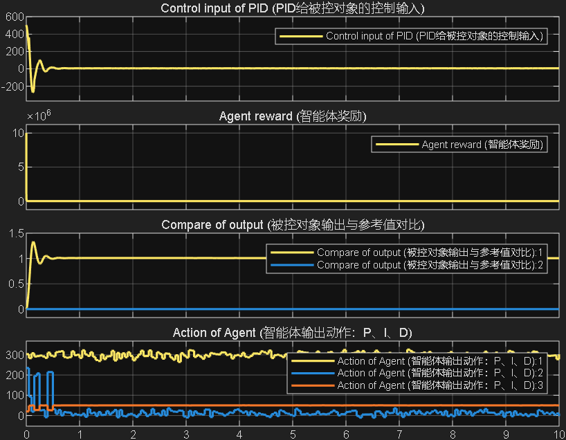
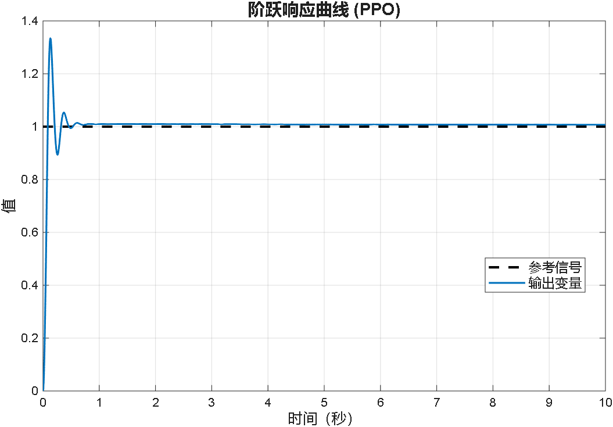
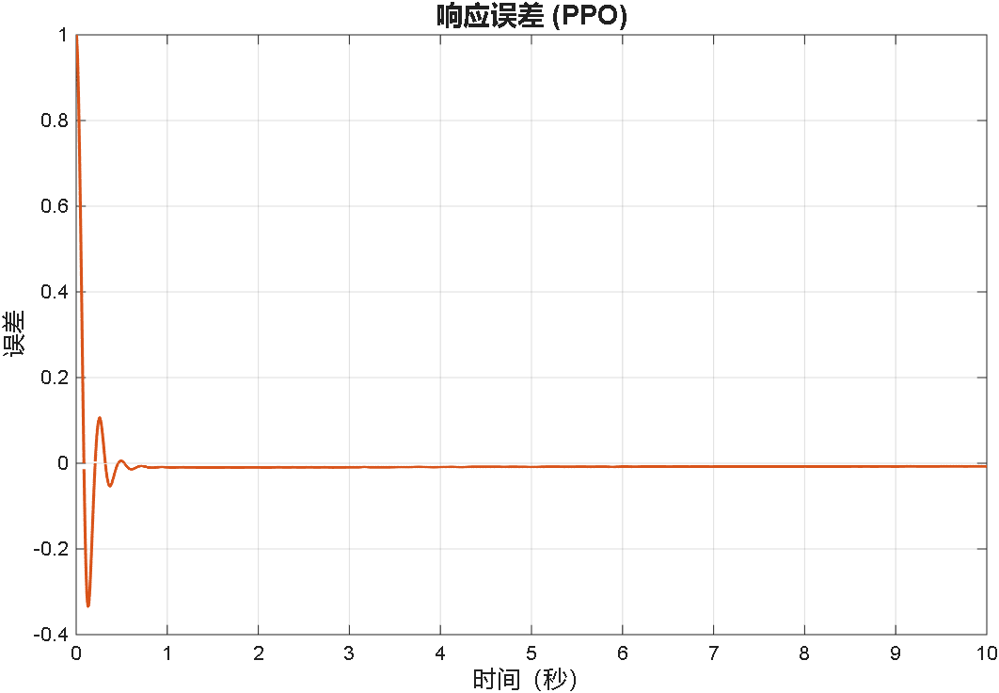
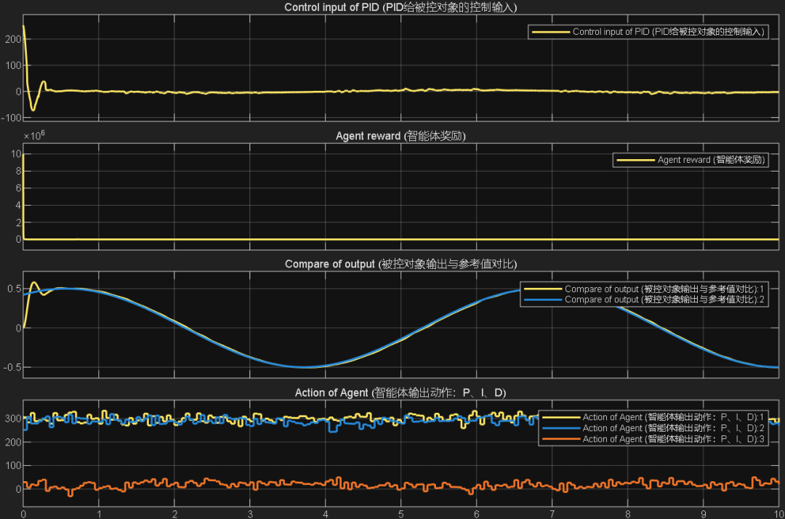
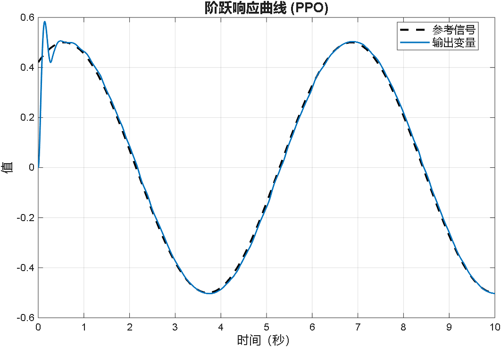
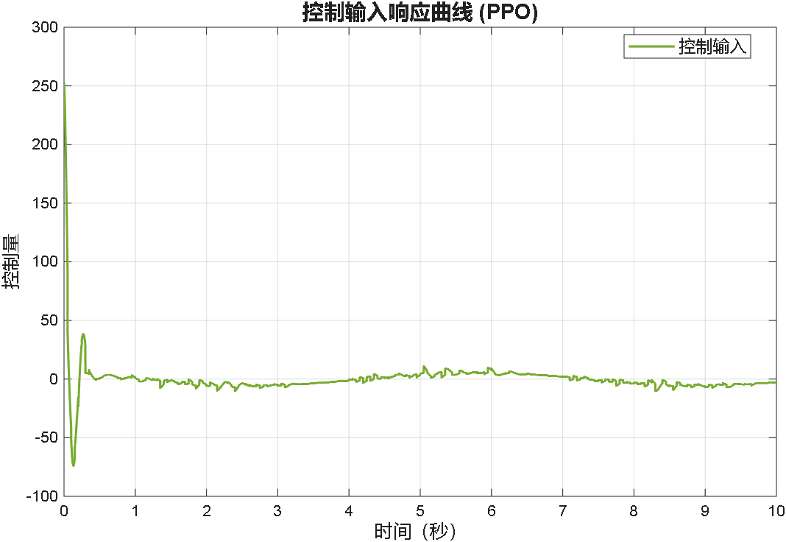
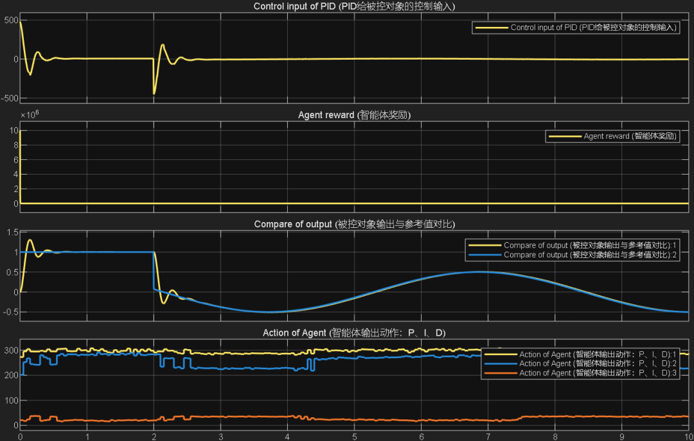
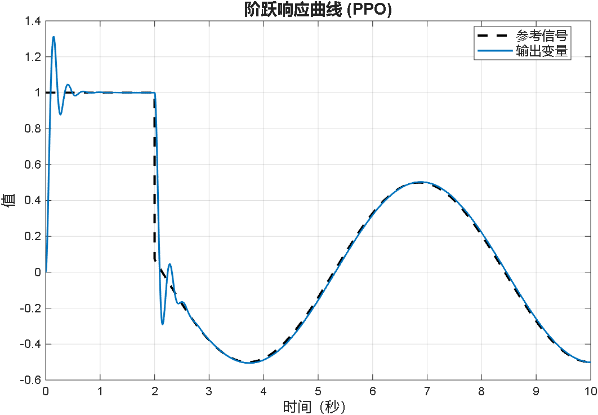
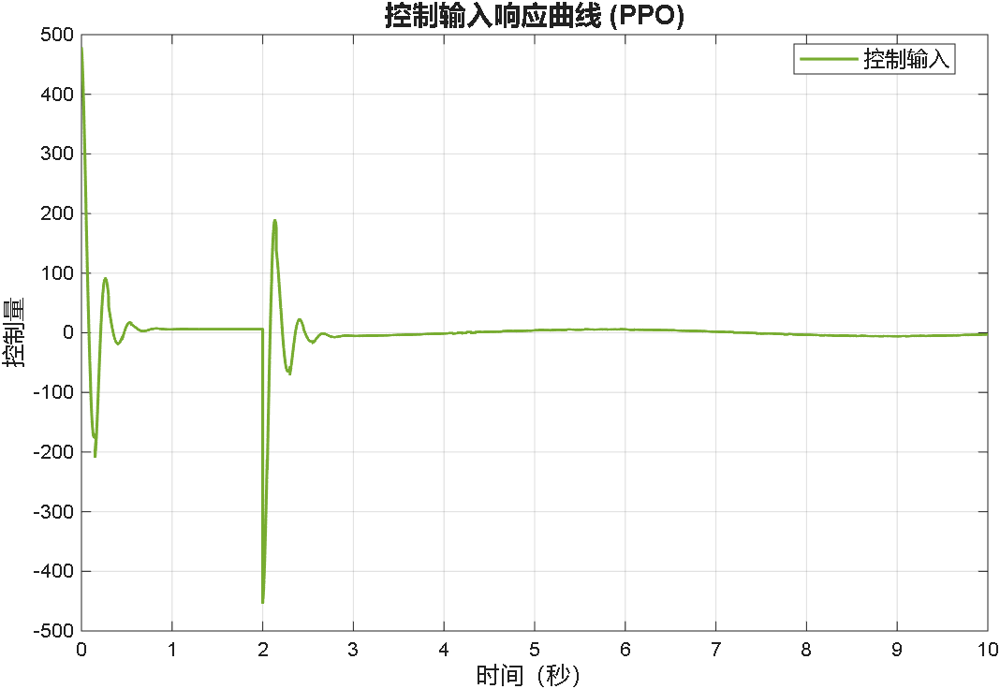
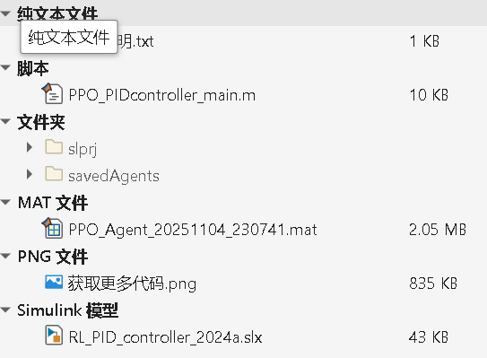

<!-- PAYMENT_BLOCK -->

## Get this dataset

- Payment link (Stripe): [Buy now](https://buy.stripe.com/3cs8yP7sY87d0vu9AB)
- Payment QR code: 

<!-- /PAYMENT_BLOCK -->
